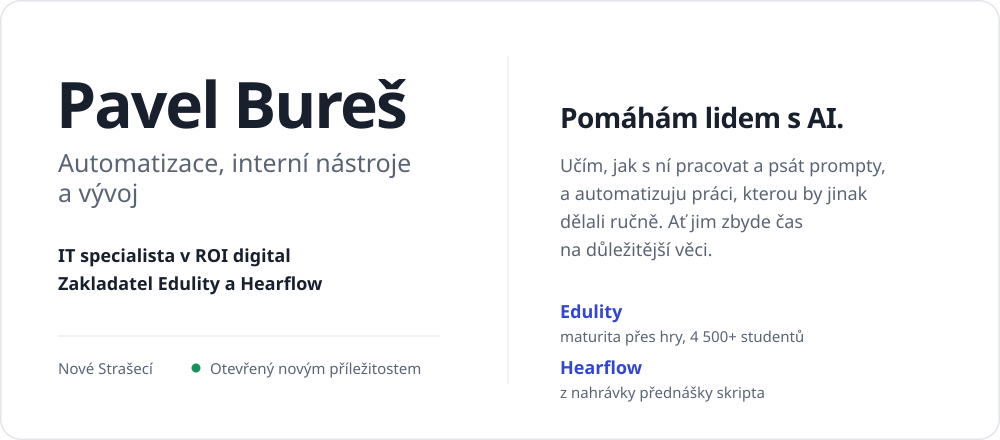

<picture>
  <source media="(prefers-color-scheme: dark)" srcset="assets/hero-dark.svg" />
  
</picture>

  <a href="https://www.linkedin.com/in/pavel-bures07/">LinkedIn</a>&nbsp;&nbsp;&nbsp;
  <a href="mailto:pavelbures07@gmail.com">pavelbures07@gmail.com</a>&nbsp;&nbsp;&nbsp;
  <a href="https://edulity.cz">edulity.cz</a>&nbsp;&nbsp;&nbsp;
  <a href="https://hearflow.app">hearflow.app</a>

## Co dělám

V ROI digital stavím automatizace a interní nástroje a učím kolegy pracovat s AI. Po práci a škole dělám na vlastních projektech.

## Projekty

| Projekt | Co to je |
| --- | --- |
| **[Edulity](https://edulity.cz)** | Na maturitu se tu připravuješ přes hry a simulace didaktických testů. Je zdarma, bez reklam a používá ho přes 4 500 studentů. |
| **[Hearflow](https://hearflow.app)** | Nahraješ přednášku a dostaneš z ní skripta. |
| **[WavePass](https://github.com/pavwlik/WavePass)** | Docházkový systém pro zaměstnance škol. |

## Nejčastěji používám

Next.js, TypeScript, Supabase a Python.

## Ozvi se

Chceš, aby AI ve tvé firmě něco opravdu ulehčila? [Napiš mi.](mailto:pavelbures07@gmail.com)
